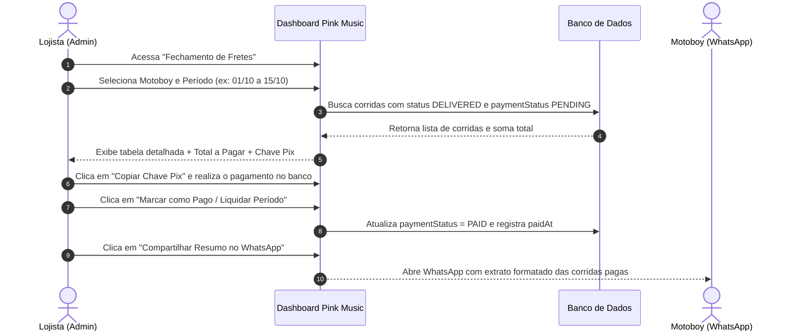

# Plano de Implementação: Gestão de Motoboys e Fechamento de Corridas

Este documento detalha o planejamento completo para implementar o controle de entregadores próprios/terceirizados (motoboys), a vinculação de pedidos/corridas e o módulo de conciliação e fechamento financeiro por período no painel administrativo da **Pink Music**.

---

## 1. Visão Geral da Arquitetura

```mermaid
flowchart TD
    subgraph Gestão de Entregadores
        A[Cadastro de Motoboys] -->|Nome, WhatsApp, Chave Pix, Placa| B[(Tabela Courier)]
    end

    subgraph Operação de Pedidos
        C[Pedido Delivery Pago] --> D[Despachar Pedido]
        D -->|Vincular Motoboy + Valor da Corrida| E[(Tabela DeliveryRide / Order)]
        E --> F[Notificação / WhatsApp para o Motoboy]
    end

    subgraph Fechamento Financeiro
        G[Módulo de Fechamento de Fretes] -->|Filtro por Período e Motoboy| H[Extrato de Corridas]
        H --> I[Cálculo de Totais: Corridas, Valor Devido, Pago]
        I --> J[Ação: Liquidar / Pagar Lote]
        J --> K[Envio de Relatório / Pix via WhatsApp]
    end
```



---

## 2. Modelagem do Banco de Dados (Prisma Schema)

Propomos a criação de um modelo dedicado para os profissionais (`Courier`) e um modelo para histórico de corridas e conciliação (`DeliveryRide`), mantendo os pedidos vinculados e preservando a integridade contábil mesmo se valores ou dados do motoboy mudarem no futuro.

```prisma
// Status da Corrida
enum DeliveryRideStatus {
  ASSIGNED    // Atribuída / Aguardando coleta
  IN_TRANSIT  // A caminho do cliente
  DELIVERED   // Entregue com sucesso
  CANCELLED   // Cancelada
}

// Status do Pagamento ao Motoboy
enum RidePaymentStatus {
  PENDING // A pagar
  PAID    // Pago / Liquidado
}

// Cadastro de Profissionais / Motoboys
model Courier {
  id          String   @id @default(cuid())
  name        String
  phone       String   // WhatsApp para contato e envio do espelho
  pixKey      String?  // Chave Pix (CPF, Telefone, E-mail, Aleatória)
  pixKeyType  String?  // "CPF" | "PHONE" | "EMAIL" | "RANDOM"
  vehicle     String?  // Ex: Honda CG 160 Fan
  plate       String?  // Placa da moto
  active      Boolean  @default(true)
  notes       String?  // Observações gerais
  createdAt   DateTime @default(now())
  updatedAt   DateTime @updatedAt

  rides       DeliveryRide[]

  @@index([active])
}

// Registro individual de cada Corrida / Frete
model DeliveryRide {
  id              String             @id @default(cuid())
  orderId         String             @unique
  order           Order              @relation(fields: [orderId], references: [id], onDelete: Restrict)
  courierId       String
  courier         Courier            @relation(fields: [courierId], references: [id], onDelete: Restrict)

  // Valores financeiros
  clientFee       Float              // Valor que o cliente pagou de frete (Order.shippingPrice)
  courierFee      Float              // Valor a ser pago ao motoboy pela corrida
  distanceKm      Float?             // Distância da rota (km)

  // Controle de Status e Pagamento
  status          DeliveryRideStatus @default(ASSIGNED)
  paymentStatus   RidePaymentStatus  @default(PENDING)
  paidAt          DateTime?          // Data em que a loja pagou o motoboy
  paymentBatchId  String?            // Identificador de lote de fechamento

  assignedAt      DateTime           @default(now())
  deliveredAt     DateTime?
  notes           String?

  createdAt       DateTime           @default(now())
  updatedAt       DateTime           @updatedAt

  @@index([courierId])
  @@index([paymentStatus])
  @@index([status])
  @@index([assignedAt])
}
```

> [!NOTE]
> Separar `clientFee` (o que o cliente pagou na loja) de `courierFee` (o que a loja efetivamente paga ao motoboy) é essencial, pois pode haver subsídio da loja, valor fixo combinado por corrida ou repasse integral.

---

## 3. Telas e Funcionalidades a Serem Desenvolvidas

| Módulo | Tela / Componente | O que faz |
| :--- | :--- | :--- |
| **1. Cadastro de Motoboys** | `/dashboard/couriers` | Listar, cadastrar, editar, ativar/inativar motoboys com nome, celular, Pix e veículo. |
| **2. Atribuição no Pedido** | `/dashboard/orders` | Modal/ação rápida ao mudar pedido para `DISPATCHED`: escolher o motoboy, confirmar o valor da corrida e enviar dados da entrega via WhatsApp com 1 clique. |
| **3. Fechamento de Fretes** | `/dashboard/couriers/settlement` | Filtro por período (data inicial e final) e por motoboy; extrato detalhado de corridas, totalizador e botão "Liquidar / Fechar Contas" com cópia da chave Pix. |
| **4. Menu Lateral** | `sidebar.tsx` | Novo item de menu "Motoboys & Fretes" sob a categoria Operações. |

---

## 4. Fluxo Passo a Passo do Fechamento de Contas



---

## 5. Roteiro de Implementação (Fases)

### Fase 1: Banco de Dados e APIs Base
- [ ] Atualizar `prisma/schema.prisma` com os modelos `Courier` e `DeliveryRide`.
- [ ] Rodar migration / `prisma db push` no banco PostgreSQL (Supabase).
- [ ] Criar rotas de API REST:
  - `GET /api/couriers` & `POST /api/couriers`: Listagem e cadastro de motoboys.
  - `GET/PUT/DELETE /api/couriers/[id]`: Edição e inativação de motoboys.
  - `POST /api/rides`: Criar/atribuir corrida ao pedido.
  - `GET /api/rides/settlement`: Relatório consolidado com filtros de data, motoboy e status.
  - `PATCH /api/rides/settlement/pay`: Liquidar corridas selecionadas ou por período.

### Fase 2: Gestão de Profissionais no Dashboard
- [ ] Criar página `/dashboard/couriers/page.tsx` com visual moderno, badges de status, contatos rápidos e formulário modal de cadastro/edição.
- [ ] Adicionar o link no menu lateral ([sidebar.tsx](file:///c:/Web/pinkmusic/src/app/dashboard/_components/sidebar.tsx)).

### Fase 3: Despacho e Vínculo de Corrida no Pedido
- [ ] Atualizar o fluxo de despacho em [src/app/dashboard/orders/page.tsx](file:///c:/Web/pinkmusic/src/app/dashboard/orders/page.tsx):
  - Ao clicar em "Despachar Entrega", abrir modal para selecionar o motoboy cadastrado.
  - Preencher automaticamente o valor sugerido (com base no frete do pedido).
  - Gerar botão de envio rápido da rota para o WhatsApp do motoboy (endereço, cliente, link Google Maps).

### Fase 4: Tela de Fechamento de Fretes (Conciliação Financeira)
- [ ] Criar aba ou tela dedicada `/dashboard/couriers/settlement`:
  - Seletor de período com atalhos: *Hoje*, *Esta Semana*, *Últimos 15 dias*, *Este Mês*, *Personalizado*.
  - Filtro por profissional específico ou todos.
  - Cards de métricas: Total de Entregas, Valor Total a Pagar, Valor já Liquidado.
  - Tabela com ações: marcar corridas como pagas individualmente ou em lote.
  - Botão de exportação/cópia de resumo para WhatsApp para enviar a prestação de contas.

---

> [!TIP]
> Caso queira prosseguir, clique em **Proceed** ou confirme aqui no chat para iniciarmos a Fase 1 (modelagem e APIs). Se preferir ajustar qualquer regra ou campo, basta nos informar!
